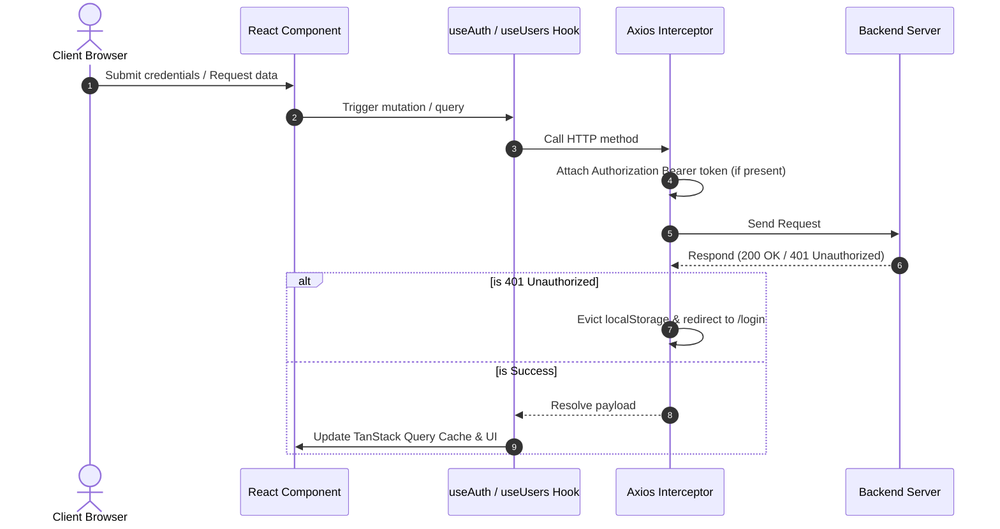

<div align="center">

# 🍕 PizzaPortal Client

**A modern, production-ready full-stack enterprise dashboard built with React 18, Vite, TypeScript, shadcn/ui, TanStack Query, and Axios.**

[](https://react.dev/)
[](https://www.typescriptlang.org/)
[](https://vitejs.dev/)
[](https://tailwindcss.com/)
[](https://tanstack.com/query)
[](https://ui.shadcn.com/)

</div>

---

## 📑 Table of Contents

- [Overview](#-overview)
- [Architecture & Design Principles](#-architecture--design-principles)
- [Key Features](#-key-features)
- [Project Structure](#-project-structure)
- [API Integration & Auth Suite](#-api-integration--auth-suite)
- [Component Highlights](#-component-highlights)
- [Getting Started](#-getting-started)
- [Environment Variables](#-environment-variables)
- [Scripts](#-scripts)
- [Best Practices & Conventions](#-best-practices--conventions)

---

## 🌟 Overview

**PizzaPortal Client** is an administrative and operations web application designed for high performance, maintainability, and clean separation of concerns. It features:
- **Feature-Driven Architecture**: Self-contained business domains (`auth`, `users`, `home`).
- **Data Synchronization**: Asynchronous state management and caching via **TanStack Query (React Query v5)**.
- **Modern UI Suite**: Modeled after **shadcn/ui** with custom HSL token theming, responsive tables, and the **Sidebar-07** block layout.
- **Robust HTTP Layer**: Pre-configured **Axios** client with automated JWT bearer attachment and global error/unauthorized interceptors.

---

## 🏗 Architecture & Design Principles

```
src/
├── components/          # Reusable design-system components & layouts
│   ├── layouts/         # High-level layouts (RootLayout, Sidebar-07)
│   ├── shared/          # Generic application widgets (spinners, alert states)
│   └── ui/              # Headless/styled shadcn/ui atomic primitives
├── features/            # Feature-Sliced domain logic (self-contained modules)
│   ├── auth/            # Auth domain: APIs, custom hooks, views, DTOs
│   ├── users/           # User management: APIs, TanStack hooks, tables
│   └── home/            # Dashboard landing domain
├── lib/                 # Core utilities, Axios instance, query keys
└── pages/               # Root wildcard/fallback routes
```

### Core Architecture Rules:
1. **Colocation**: Everything related to a single business capability (types, API calls, custom hooks, UI components, pages) lives in `src/features/<feature-name>`.
2. **Public API (Barrel Exports)**: External consumers must only import from `src/features/<feature-name>` index exports, keeping internal implementations private and swappable.
3. **Query Key Factory Pattern**: All React Query cache keys are strictly organized centrally in `src/lib/queryKeys.ts` to prevent cache collisions and streamline invalidations.

---

## ⚡ Key Features

- **shadcn Sidebar-07 Pattern**: Collapsible sidebar with group headers, expandable states, tooltips, responsive toggle triggers, and profile actions.
- **shadcn Table System**: Composable, accessible table components featuring real-time client-side search filtering, column sorting, and responsive view switcher (Table vs. Cards).
- **Comprehensive Auth Suite**: Full coverage of the backend auth lifecycle including user login, admin role portal, user registration, email token verification, forgot-password requests, and password reset forms.
- **Optimistic Caching & Mutations**: Deleting or modifying records reflects immediately on UI cache with automatic rollbacks on network failure.
- **JWT & Interceptor Automation**: Local storage auth sync and automatic `401 Unauthorized` redirect handling.

---

## 📁 Project Structure

```bash
my-app/
├── public/                      # Static assets
├── src/
│   ├── components/
│   │   ├── layouts/
│   │   │   ├── AppSidebar.tsx   # Sidebar-07 implementation
│   │   │   └── RootLayout.tsx   # Main shell with SidebarProvider
│   │   ├── shared/
│   │   │   ├── ErrorMessage.tsx
│   │   │   └── LoadingSpinner.tsx
│   │   └── ui/                  # shadcn atomic components
│   │       ├── button.tsx
│   │       ├── card.tsx
│   │       ├── input.tsx
│   │       ├── label.tsx
│   │       ├── sidebar.tsx      # Sidebar context, provider & components
│   │       ├── table.tsx        # shadcn Table, Head, Body, Cell, Row
│   │       └── index.ts
│   ├── features/
│   │   ├── auth/
│   │   │   ├── api/auth.api.ts
│   │   │   ├── hooks/useAuth.ts
│   │   │   ├── pages/
│   │   │   │   ├── LoginPage.tsx
│   │   │   │   ├── AdminLoginPage.tsx
│   │   │   │   ├── RegisterPage.tsx
│   │   │   │   ├── ForgotPasswordPage.tsx
│   │   │   │   ├── ResetPasswordPage.tsx
│   │   │   │   └── VerifyEmailPage.tsx
│   │   │   ├── types/auth.types.ts
│   │   │   └── index.ts
│   │   ├── users/
│   │   │   ├── api/users.api.ts
│   │   │   ├── components/
│   │   │   │   ├── UserCard.tsx
│   │   │   │   └── UserTable.tsx
│   │   │   ├── hooks/
│   │   │   │   ├── useUsers.ts
│   │   │   │   ├── useUser.ts
│   │   │   │   └── useDeleteUser.ts
│   │   │   ├── pages/UsersPage.tsx
│   │   │   ├── types/user.types.ts
│   │   │   └── index.ts
│   │   └── home/
│   │       └── pages/HomePage.tsx
│   ├── lib/
│   │   ├── axios.ts             # Axios client with interceptors
│   │   ├── queryKeys.ts         # Central TanStack Query key factory
│   │   └── utils.ts             # cn utility (clsx + tailwind-merge)
│   ├── App.tsx                  # Application routing table
│   ├── index.css                # Tailwind base + shadcn design tokens
│   └── main.tsx                 # Providers entry point
├── components.json              # shadcn configuration
├── tailwind.config.js           # Tailwind theme configuration
├── tsconfig.json                # TypeScript root configuration
├── tsconfig.app.json            # App TS settings & @/ alias
└── vite.config.ts               # Vite configuration & path resolvers
```

---

## 🔐 API Integration & Auth Suite

The application implements full client-side integration for the backend authentication contract:

| Endpoint | Method | Custom Hook | Target Page | Purpose |
| :--- | :---: | :--- | :--- | :--- |
| `/auth/login` | `POST` | `useLogin()` | `LoginPage.tsx` | Standard user authentication |
| `/auth/admin-login` | `POST` | `useAdminLogin()` | `AdminLoginPage.tsx` | Administrative role-guarded sign in |
| `/auth/register` | `POST` | `useRegister()` | `RegisterPage.tsx` | Account registration & verification dispatch |
| `/auth/verify-email/:token` | `GET` | `useVerifyEmail()` | `VerifyEmailPage.tsx` | Validates email token from param or query |
| `/auth/forgot-password` | `POST` | `useForgotPassword()` | `ForgotPasswordPage.tsx` | Triggers reset token email transmission |
| `/auth/reset-password` | `POST` | `useResetPassword()` | `ResetPasswordPage.tsx` | Submits token and new password update |

### Network Request Flow


---

## 🎨 Component Highlights

### 1. shadcn Block: Sidebar-07
- Located in `src/components/ui/sidebar.tsx` and implemented in `src/components/layouts/AppSidebar.tsx`.
- Controlled via context with `SidebarProvider` and `useSidebar()`.
- Responsive collapsible states (compact `w-16` vs. full `w-64`) with smooth CSS transitions.

### 2. shadcn Table: User Management
- Located in `src/features/users/components/UserTable.tsx`.
- Accessible semantic markup: `<table>`, `<thead>`, `<tbody>`, `<th>`, `<td>`.
- Live client-side keyword search across `name`, `email`, and `company`.
- Ascending/Descending column sorting via `ArrowUpDown`.
- Direct action triggers with optimistic deletion feedback.

---

## 🚀 Getting Started

### Prerequisites
- **Node.js**: `v18.0.0` or higher (recommended: `v20.x` or `v22.x`)
- **Package Manager**: `npm` (v9+) or `pnpm` (v8+)

### Installation

1. **Navigate to the project root:**
   ```bash
   cd my-app
   ```

2. **Install dependencies:**
   ```bash
   npm install
   ```

3. **Configure Environment Variables:**
   ```bash
   cp .env.example .env
   ```

4. **Start the development server:**
   ```bash
   npm run dev
   ```
   The application will be running at `http://localhost:5173`.

---

## ⚙️ Environment Variables

Create a `.env` file in the project root:

```env
# URL for the Pizza Delivery backend API
VITE_API_BASE_URL=https://jsonplaceholder.typicode.com
```

*Note: In development, you can point `VITE_API_BASE_URL` to your local backend server (e.g. `http://localhost:5000/api`).*

---

## 📜 Scripts

| Command | Description |
| :--- | :--- |
| `npm run dev` | Starts Vite local development server with HMR |
| `npm run build` | Runs TypeScript type checking (`tsc -b`) and builds production bundles |
| `npm run preview` | Locally serves the production build in `./dist` |
| `npm run lint` | Lints project files using ESLint rules |

---

## 💎 Best Practices & Conventions

- **Path Aliases**: Always use `@/...` to import project files (mapped to `src/...` in `vite.config.ts` and `tsconfig.app.json`).
- **Strict Typing**: No `any` types for domain DTOs. Keep interfaces updated in `features/*/types/*.types.ts`.
- **Query Cache Invalidation**: Never manually update query states without referencing `queryKeys` factory definitions.

---

<div align="center">
  <sub>Engineered with precision for full-stack excellence.</sub>
</div>
