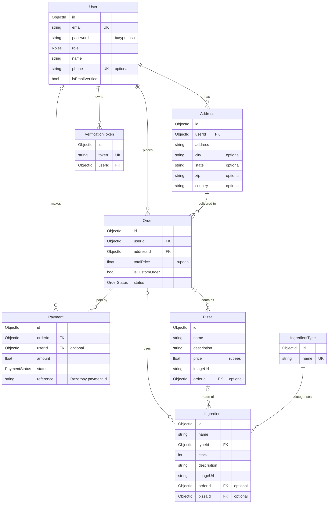

# Data model

The database is **MongoDB**, accessed through **Prisma**. The schema is defined in [`backend/prisma/schema.prisma`](../WebDev-L2-Task1-Pizza-Delivery-Full-Stack-Application/backend/prisma/schema.prisma), which is the single source of truth: change the schema there, then run `npx prisma db push` and `npx prisma generate`.

Every model has an `id` (a MongoDB ObjectId stored as `_id`) plus `createdAt` and `updatedAt` timestamps, maintained automatically.

---

## Entity relationship diagram



`UK` = unique, `FK` = reference to another model's id.

---

## Models

### `User`

An account. `role` controls access; only `ADMIN` is used by the API today (`COOK` and `DELIVERY` are reserved for future staff dashboards). `password` always holds a bcrypt hash, never the plain password.

### `Address`

A delivery address. A new one is created for **every** order, so a user collects one address per order rather than reusing saved addresses.

### `Order`

One checkout. `totalPrice` is in rupees. `isCustomOrder` is `true` when the order came from the pizza builder; in that case the chosen ingredients are linked directly to the order instead of through a `Pizza`.

### `Pizza`

A menu item managed by admins.

### `Ingredient`

An inventory item (a base, sauce, cheese or vegetable) with a `stock` count. Stock is reduced by 1 for every order that uses it and can be set by admins.

### `IngredientType`

The category of an ingredient, for example `Base`, `Sauce`, `Cheese`, `Vegetable`. The admin dashboard and the pizza builder group ingredients by this name, so the names should contain those words.

### `VerificationToken`

A random one-time token, used for **both** email verification and password reset. All of a user's tokens are deleted once one is used. Tokens have no expiry date.

### `Payment`

A record of a successful payment. `reference` holds the Razorpay payment id.

---

## Enums

**`Roles`**: `ADMIN`, `USER`, `COOK`, `DELIVERY`

**`OrderStatus`**: `PENDING`, `CONFIRMED`, `IN_PROGRESS`, `SENT_TO_KITCHEN`, `READY_FOR_DELIVERY`, `SENT_TO_DELIVERY`, `DELIVERED_TO_CUSTOMER`, `CANCELLED`

The task brief asks for *Order Received → In Kitchen → Sent to Delivery*. These map to `CONFIRMED` → `SENT_TO_KITCHEN` → `SENT_TO_DELIVERY`.

**`PaymentStatus`**: `PENDING`, `COMPLETED`, `FAILED`, `REFUNDED` (only `COMPLETED` is written today)

---

## Design issue: ingredient and pizza relations

`Ingredient` has a single optional `pizzaId` and a single optional `orderId`, and `Pizza` has a single optional `orderId`. That makes these **one-to-many** relations, which means:

- An ingredient can belong to only **one** pizza. Creating a second pizza with "Mozzarella" moves Mozzarella away from the first pizza.
- A pizza or ingredient can be linked to only **one** order. Each new order that connects them unlinks them from the previous order, so order history is overwritten.

What the domain actually needs is **many-to-many**: a pizza has many ingredients and an ingredient appears in many pizzas; an order has many pizzas and a pizza appears in many orders. On MongoDB, Prisma models this with an array of ids on both sides:

```prisma
model Pizza {
  // ...
  ingredientIds String[]     @db.ObjectId
  ingredients   Ingredient[] @relation(fields: [ingredientIds], references: [id])
}

model Ingredient {
  // ...
  pizzaIds String[] @db.ObjectId
  pizzas   Pizza[]  @relation(fields: [pizzaIds], references: [id])
}
```

For orders, a common and more robust approach is an `OrderItem` model that stores a **snapshot** of what was bought (name, price, chosen ingredients) at the time of purchase, so later menu changes do not rewrite past orders.

This is tracked in [known issues](known-issues.md).
